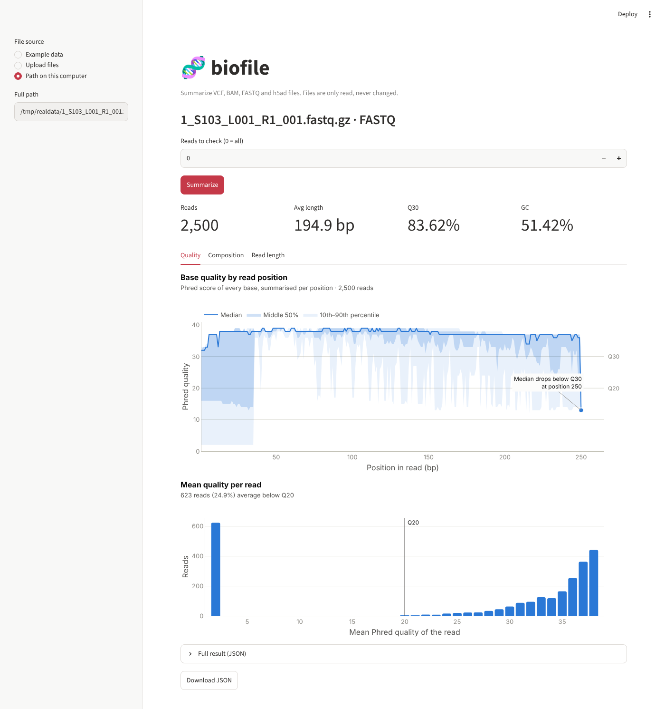
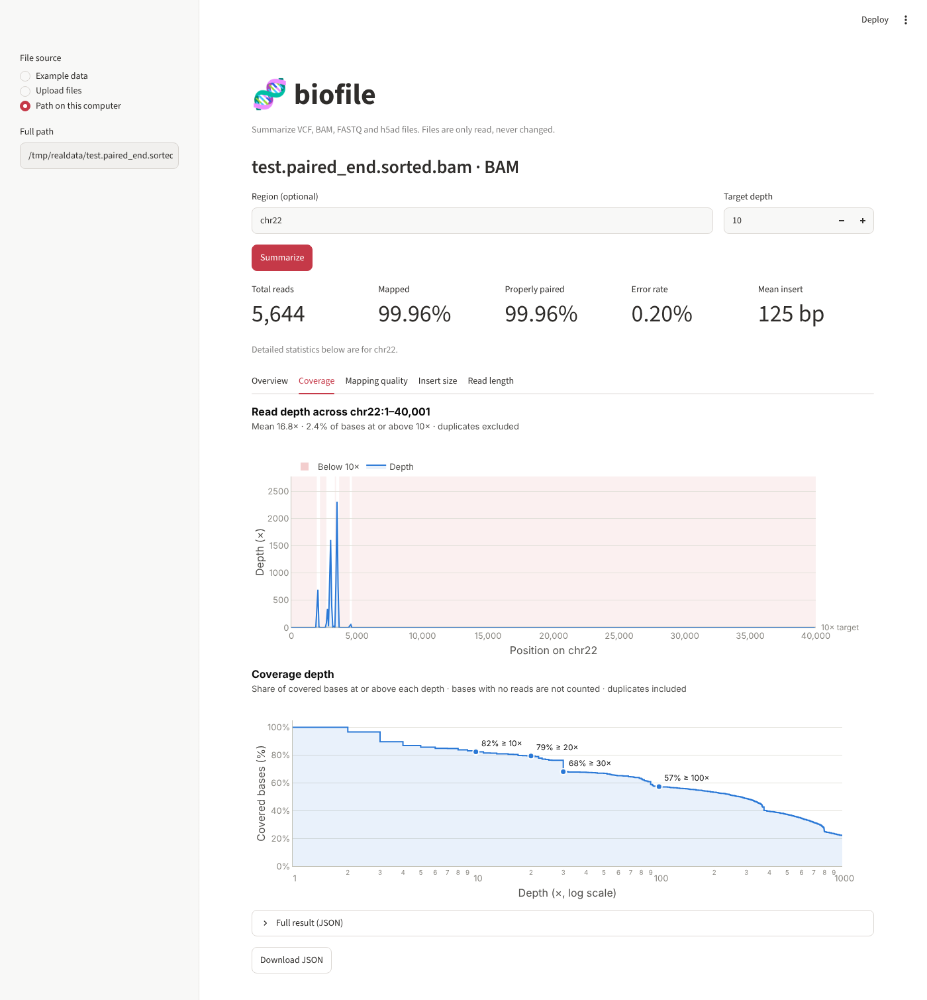
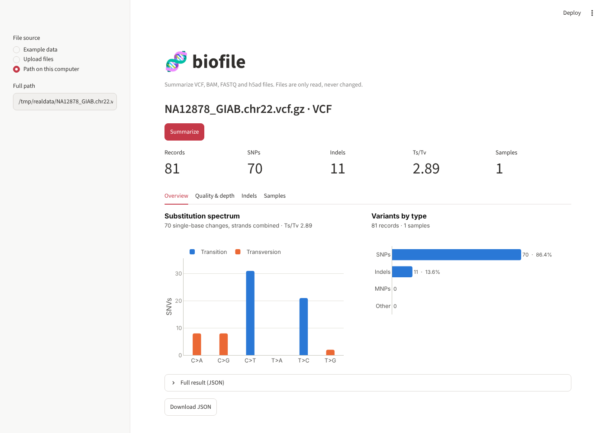
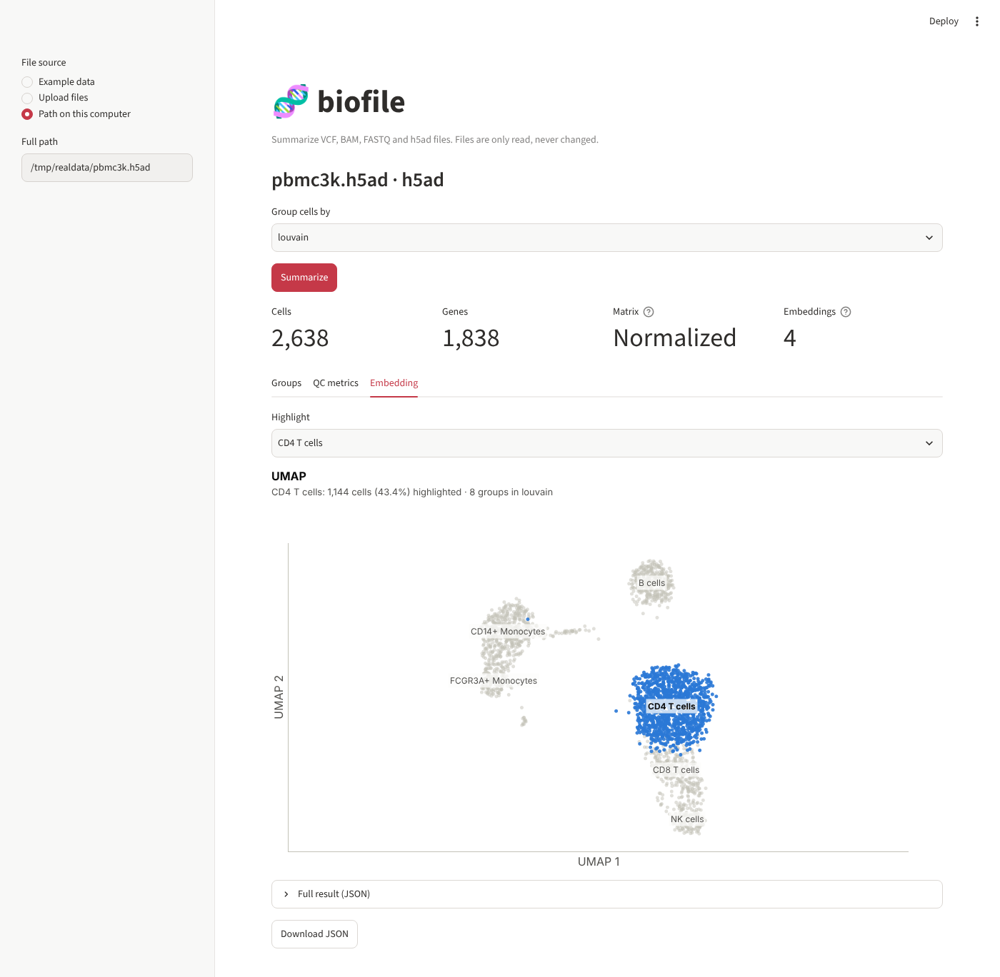
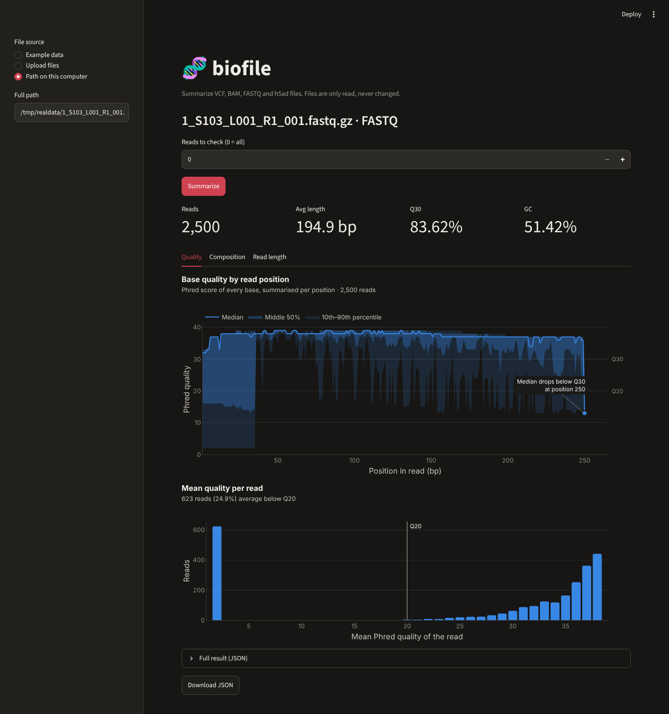

# biofile-mcp

[](https://github.com/kshitizregmi/biofile-mcp/actions/workflows/tests.yml)

An MCP server that lets AI assistants (Claude Code, Claude Desktop, Cursor, local models)
read and summarize genomics files: VCF, BAM, FASTQ and single-cell h5ad.
It returns small JSON summaries, so large files never go into the model's context.
Files stay on your machine; the tools are read-only.

The same functions can also be used from the terminal or from a web interface,
with no AI involved.

## Tools

| Tool | Input | Returns |
|---|---|---|
| `vcf_stats` | VCF / VCF.gz | samples, records, SNPs, indels, Ts/Tv, substitution counts, QUAL and genotype-depth distributions, indel lengths, per-sample genotype counts (via bcftools stats) |
| `bam_stats` | BAM (+ optional region) | total / mapped / duplicate reads; region read count, % covered, mean depth (via samtools) |
| `bam_qc` | BAM (+ optional region) | full QC from samtools stats: pairing, error rate, base quality, MAPQ, insert size, read length and coverage distributions, reads per contig |
| `bam_depth_profile` | BAM + region | per-base read depth along the region (binned for long regions), % of bases at a target depth |
| `h5ad_summary` | h5ad (+ optional column) | cells, genes, metadata, embeddings, raw-counts check, cells per category |
| `h5ad_column_stats` | h5ad + column | distribution of one cell-metadata column: quartiles and histogram (numeric) or counts (categorical) |
| `fastq_stats` | FASTQ / FASTQ.gz | reads, lengths, Q20/Q30, GC, N, lowercase and per-base counts (via pyfastx) |
| `fastq_quality_profile` | FASTQ / FASTQ.gz | quality and base composition by read position, where the median drops below Q30/Q20, per-read quality and GC distributions, read-length histogram |

See [`examples/`](examples/) for real output: the JSON each tool returns, a full
MCP session transcript and the matching server log.

## Getting started

Works on Linux and macOS. On Windows, use WSL (pysam does not support Windows).

### 1. Clone the repository

```bash
git clone https://github.com/kshitizregmi/biofile-mcp.git
cd biofile-mcp
```

All commands below are run from this `biofile-mcp` folder.

### 2. Create the environment

With conda (recommended):

```bash
conda env create -f environment.yml
conda activate biofile
```

Or with plain Python 3.12+:

```bash
python3 -m venv .venv
source .venv/bin/activate
pip install -r requirements.txt -r requirements-dev.txt
```

Activate the environment every time you open a new terminal
(`conda activate biofile`, or `source .venv/bin/activate`). To leave it, run
`conda deactivate` (or `deactivate`). After pulling new changes, update it with
`conda env update -f environment.yml --prune`.

### 3. Create the example files

```bash
python make_test_data.py
```

This writes a small VCF, BAM, FASTQ and h5ad file to `test_data/`. Their
contents are known in advance, so you can check the results.

### 4. Check that everything works

```bash
python -m pytest
```

All tests should pass.

## Try it with real public data

Small real files for every format: 16S amplicon reads (nf-core/ampliseq test
data), human reads and variants on chr22 (nf-core test data, Genome in a Bottle
NA12878), and the PBMC 3k single-cell dataset. About 25 MB in total.

```bash
mkdir -p real_data && cd real_data
curl -L -O https://raw.githubusercontent.com/nf-core/test-datasets/ampliseq/testdata/1_S103_L001_R1_001.fastq.gz -O https://raw.githubusercontent.com/nf-core/test-datasets/modules/data/genomics/homo_sapiens/illumina/bam/test.paired_end.sorted.bam -O https://raw.githubusercontent.com/nf-core/test-datasets/modules/data/genomics/homo_sapiens/illumina/bam/test.paired_end.sorted.bam.bai -O https://raw.githubusercontent.com/nf-core/test-datasets/modules/data/genomics/homo_sapiens/illumina/vcf/NA12878_GIAB.chr22.vcf.gz -O https://raw.githubusercontent.com/chanzuckerberg/cellxgene/main/example-dataset/pbmc3k.h5ad
cd ..
```

| File | What to look at |
|---|---|
| `1_S103_L001_R1_001.fastq.gz` | 2,500 16S reads of 35-250 bp, 83.6% of bases at Q30 or better |
| `test.paired_end.sorted.bam` | 5,644 reads, 99.96% mapped; use region `chr22` with target depth 10 |
| `NA12878_GIAB.chr22.vcf.gz` | 81 variants (70 SNPs, 11 indels), Ts/Tv 2.89 |
| `pbmc3k.h5ad` | 2,638 cells x 1,838 genes; count cells by `louvain` for 8 cell types |

`real_data/` is ignored by git.

## Use it from the terminal

### Summarize a file

```bash
python main.py test_data/test.vcf
python main.py test_data/test.bam --region chr1:1001-1100
python main.py test_data/small.h5ad --column cell_type
python main.py test_data/sample_R1.fastq --max-reads 100
```

Each command prints the summary as JSON. Use the path of any of your own files
instead of `test_data/...`.

### Run the MCP server

```bash
export BIOFILE_ALLOWED_DIR=$PWD/test_data
python server.py
```

The server prints one log line and then waits: it talks to an MCP client over
stdin/stdout, so nothing more happens until a client connects. Press
**Ctrl+C** to stop it. `BIOFILE_ALLOWED_DIR` is the only folder the server may
read from; point it at your own data folder to use real files.

You don't normally start the server yourself. An MCP client (the Inspector
below, Claude Code, Claude Desktop) starts it for you.

### Call the tools without an AI client

The [MCP Inspector](https://github.com/modelcontextprotocol/inspector) can start
the server and call its tools directly from the terminal. It needs
[Node.js](https://nodejs.org/) (on macOS: `brew install node`).

List the tools:

```bash
npx @modelcontextprotocol/inspector --cli -e BIOFILE_ALLOWED_DIR=$PWD/test_data python server.py --method tools/list
```

Call a tool:

```bash
npx @modelcontextprotocol/inspector --cli -e BIOFILE_ALLOWED_DIR=$PWD/test_data python server.py --method tools/call --tool-name vcf_stats --tool-arg path=test.vcf
```

Pass several arguments after `--tool-arg`:

```bash
npx @modelcontextprotocol/inspector --cli -e BIOFILE_ALLOWED_DIR=$PWD/test_data python server.py --method tools/call --tool-name bam_stats --tool-arg path=test.bam region=chr1:1001-1100
```

To click through the tools in a browser instead, leave out `--cli` and
everything after `server.py`:

```bash
npx @modelcontextprotocol/inspector -e BIOFILE_ALLOWED_DIR=$PWD/test_data python server.py
```

It prints a link. Open it, press **Connect**, then open the **Tools** tab.
Press **Ctrl+C** in the terminal when you are done.

Without Node.js, this script plays the client's part, calls every tool and
saves the results to `examples/`:

```bash
python examples/run_examples.py
```

## Use the web interface

```bash
streamlit run app.py
```

Your browser opens at http://localhost:8501. Then:

1. In the sidebar, choose a file source: **Example data**, **Upload files**, or
   **Path on this computer** (best for large files, which are read in place).
2. If you upload several files, pick the one to summarize from the list at the
   top of the page; the newest upload is selected for you. The format is
   detected automatically, from the file's contents if the name doesn't say.
   For a BAM, upload its `.bai` index too, or one is built for you.
3. Set the options for that file type: a region and target depth for BAM, a
   column to count cells by for h5ad, how many reads to check for FASTQ.
4. Press **Summarize**.

Press **Ctrl+C** in the terminal to stop the app.

Results are organised in tabs:

| File | Tabs and charts |
|---|---|
| BAM | **Overview**: where the reads went, reads per contig, detail table · **Coverage**: depth along a region with low-coverage stretches shaded, share of bases at each depth · **Mapping quality** · **Insert size** · **Read length** |
| FASTQ | **Quality**: quality by read position with the Q30 drop marked, mean quality per read · **Composition**: base composition by position, GC per read, base counts · **Read length** |
| VCF | **Overview**: substitution spectrum, variants by type · **Quality & depth**: QUAL and genotype depth · **Indels**: lengths of insertions and deletions · **Samples**: genotype counts per sample |
| h5ad | **Groups**: cells per category of any `obs` column · **QC metrics**: histograms of every numeric `obs` column · **Embedding**: UMAP/t-SNE with one group highlighted, or colored by a numeric column |



<details>
<summary>More screenshots</summary>






</details>

Charts follow the app's light or dark theme, and each can be downloaded as a
PNG from its toolbar. Uploads are limited to 200 MB by default; raise the limit
with `streamlit run app.py --server.maxUploadSize 2000`, or use the path option.
When hosting the app for other people, set `BIOFILE_UPLOAD_ONLY=1` so visitors
cannot read files on the server by path.

## Connect to an AI assistant

### Claude Code plugin

The quickest way. The plugin installs the server, its Python packages and a
`genomics-qc` skill that tells Claude which tool to use for a question and how
to judge the numbers (typical Q30, mapping rate, duplicate, Ts/Tv and
single-cell QC ranges). You only need Python 3.10 or newer; no conda and no
clone.

```bash
claude plugin marketplace add kshitizregmi/biofile-mcp@claude-plugin
claude plugin install biofile@biofile-mcp --config data_dir=/full/path/to/your/data
```

The first session takes a few seconds longer while the Python packages install
into Claude Code's plugin data folder. After that, ask questions as below, or
run `/biofile:genomics-qc` with a file name for a full QC report. Change the
data folder later with `/config`.

Plugin files on this branch:

| File | Purpose |
|---|---|
| `.claude-plugin/plugin.json` | plugin manifest: MCP server and the data-folder setting |
| `.claude-plugin/marketplace.json` | lets this repository act as its own plugin marketplace |
| `skills/genomics-qc/` | the QC skill and its reference table of typical ranges |
| `hooks/hooks.json` | installs the Python packages when a session starts |
| `scripts/install.sh`, `scripts/start-server.sh` | build the environment and start the server |
| `requirements-server.txt` | packages the server needs (no web interface) |

### Claude Code without the plugin

The setup script creates or updates the conda environment, runs the tests and
registers the server in one step:

```bash
bash setup.sh ~/path/to/your/data
```

Or register it yourself. Run `which python` with the environment active to get
the full Python path:

```bash
claude mcp add biofile -e BIOFILE_ALLOWED_DIR=/full/path/to/your/data -- /full/path/to/python /full/path/to/biofile-mcp/server.py
```

Check it with `claude mcp list`, then ask things like:

- "What's the Ts/Tv ratio of test.vcf?"
- "How many cells of each type are in small.h5ad?"
- "Where does read quality drop in sample_R1.fastq? Should I trim?"

### Claude Desktop and other clients

Most MCP clients take the same three settings: the command, its arguments and
environment variables. For Claude Desktop, open **Settings → Developer → Edit
Config** and add this inside `"mcpServers"`, then restart the app:

```json
"biofile": {
  "command": "/full/path/to/python",
  "args": ["/full/path/to/biofile-mcp/server.py"],
  "env": { "BIOFILE_ALLOWED_DIR": "/full/path/to/your/data" }
}
```

## Configuration and logs

| Variable | Default | Meaning |
|---|---|---|
| `BIOFILE_ALLOWED_DIR` | current folder | only files inside this folder can be read |
| `BIOFILE_LOG_LEVEL` | `INFO` | `DEBUG`, `INFO`, `WARNING` or `ERROR` |
| `BIOFILE_LOG_FILE` | none | also write logs to this file |
| `BIOFILE_UPLOAD_ONLY` | not set | web interface only: set to `1` to hide the path option |

Every tool call is logged with its arguments, duration and outcome:

```
2026-11-06 21:40:12,517 INFO biofile: call vcf_stats path=test.vcf args={}
2026-11-06 21:40:12,548 INFO biofile: done vcf_stats in 0.03s
2026-11-06 21:40:15,102 WARNING biofile: refused vcf_stats: /etc/passwd is outside the allowed folder ...
```

Logs go to stderr (and the log file, if set), never to stdout, because over stdio
stdout carries the MCP protocol messages.

## Project layout

```
biofile-mcp/
├── biofile/              # plain Python functions: all the logic lives here
│   ├── vcf.py
│   ├── bam.py
│   ├── h5ad.py
│   └── fastq.py
├── server.py             # MCP server: exposes the functions as tools, with logging
├── main.py               # command-line interface
├── app.py                # web interface (Streamlit)
├── plots.py              # Plotly figures used by the web interface
├── make_test_data.py     # small test files with known answers
├── tests/                # pytest suite, including a real MCP client test
├── examples/             # captured server output: results, session transcript, log
├── docs/screenshots/     # screenshots of the web interface
├── environment.yml       # conda environment
├── requirements.txt      # pip dependencies (requirements-dev.txt adds pytest)
├── setup.sh              # one-step setup for Claude Code
├── .claude-plugin/       # Claude Code plugin manifest and marketplace
├── skills/genomics-qc/   # QC skill shipped with the plugin
├── hooks/, scripts/      # plugin install hook and server launcher
└── .github/workflows/    # CI: runs the tests on Linux and macOS
```

## Tests

```bash
python -m pytest -v
```

To also test on the real public datasets listed above (downloaded once into
`real_data/`, about 25 MB; skipped if there is no internet connection):

```bash
python -m pytest -m real_data -v
```

The suite checks every tool against files with known answers (e.g. Ts/Tv 2.0,
92% mapped reads, 100/60/40 cells per type), error cases (empty or invalid
files, wrong contig names, unknown columns), the allowed-folder checks
(including `../` escapes), logging, every chart, the web interface, and an
end-to-end test where an MCP client starts `server.py` over stdio and calls
the tools. The real-data tests check every tool, the MCP server and the web
interface against values measured on the real files (e.g. 2,500 16S reads,
5,644 reads on chr22, Ts/Tv 2.89 for NA12878, 1,144 CD4 T cells in PBMC 3k).

## Safety

- Read-only: no tool writes, moves or deletes files.
- Only files inside `BIOFILE_ALLOWED_DIR` can be read; other paths, including `../` escapes, are refused.
- Errors are returned to the caller as clear messages so the request can be corrected.

## License

MIT. See [LICENSE](LICENSE).
