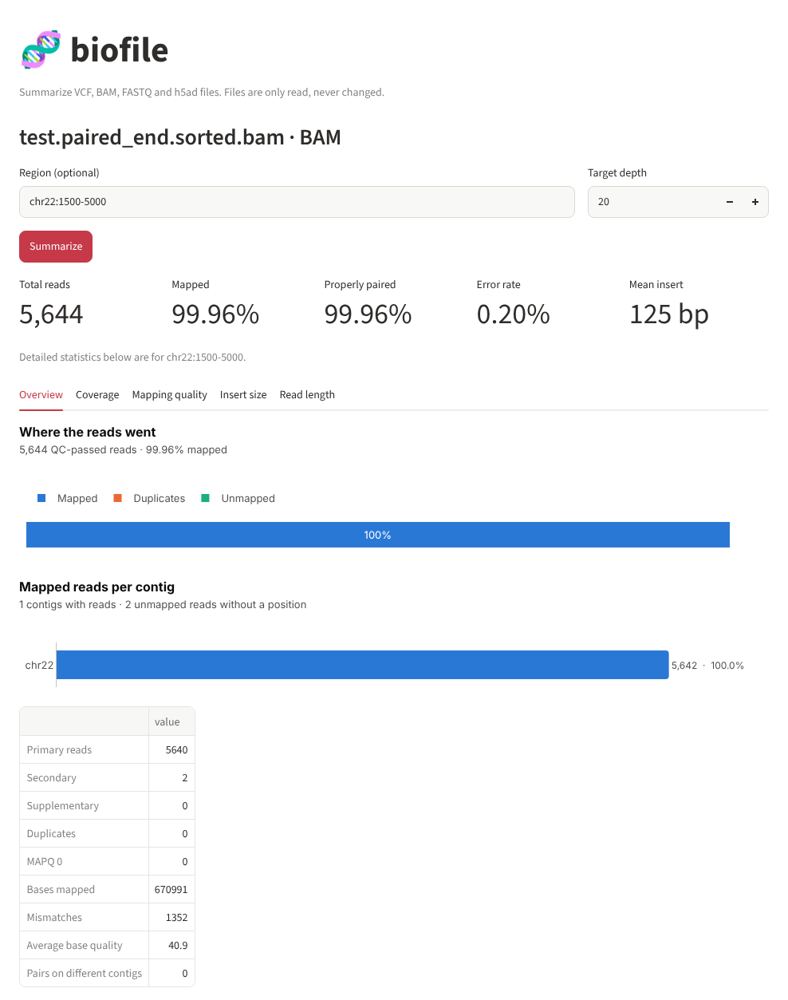
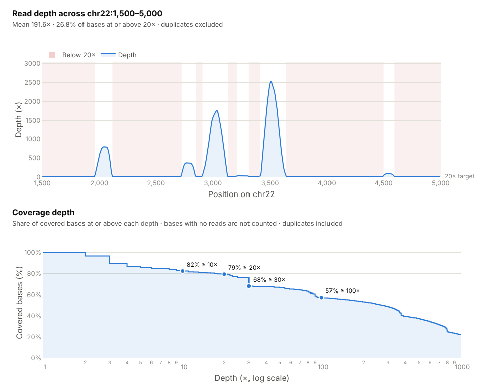
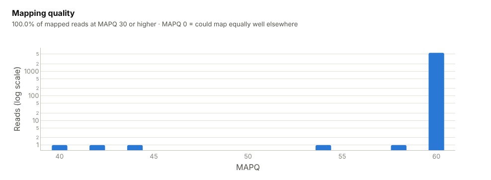
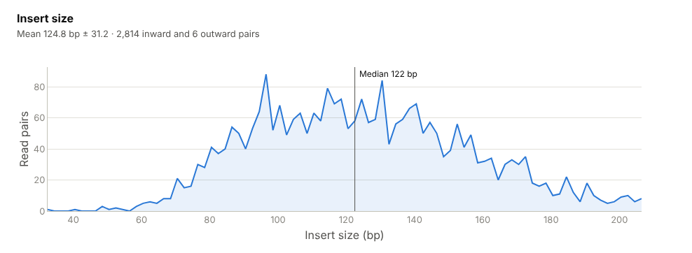
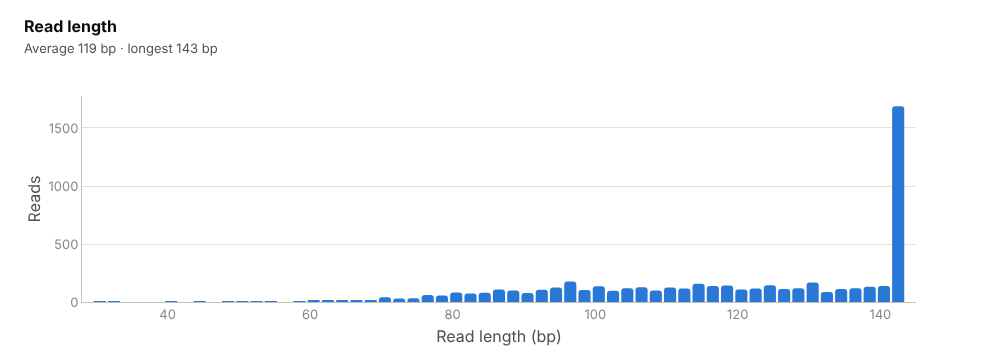

# BAM: aligned reads

[Guide home](README.md) · [FASTQ](fastq.md) · **BAM** · [VCF](vcf.md) · [h5ad](h5ad.md)

## What a BAM file is

A BAM file holds reads after they have been aligned (mapped) to a reference
genome: for every read, where in the genome it belongs and how well it fits.
An aligner such as BWA, Bowtie2 or STAR turns FASTQ files into a BAM. It is the
input for variant calling, coverage analysis and expression counting, so a
poor alignment shows up as missing or false results later on.

BAM is the compressed, binary form of the text SAM format. It cannot be read
with a text editor; `samtools view` prints it as text.

## What is inside

A **header**, listing the reference sequences and how the file was made:

```
@HD  VN:1.6  SO:coordinate                     ← sorted by position
@SQ  SN:chr22  LN:40001                        ← one reference contig, 40,001 bases
@RG  ID:1  SM:testN  PL:illumina               ← sample name and platform
@PG  ID:bwa  PN:bwa  VN:0.7.17-r1188  CL:bwa mem ... -M genome.fasta test_1.retry.fq.gz test_2.retry.fq.gz
                                               ← the aligner and the command that made the file
```

Then one **record per read**. This is a real record from the example file,
split into its columns:

| Column | Value | Meaning |
|---|---|---|
| Read name | `testN:1497` | Same name for both reads of a pair |
| Flag | `99` | Bit flags: paired, properly paired, mate on the reverse strand, first read of the pair |
| Contig, position | `chr22`, `3366` | Where the read starts on the reference |
| MAPQ | `60` | Mapping quality: the aligner's confidence that this is the right place (60 is the maximum for BWA) |
| CIGAR | `143M` | How the read lines up: 143 bases aligned, no gaps |
| Mate position | `=`, `3454` | The other read of the pair is on the same contig at 3454 |
| Insert size | `231` | Length of the DNA fragment the two reads came from |
| Sequence, qualities | `TTTTCTTTAG...` | The read itself, as in the FASTQ |
| Tags | `NM:i:1` | Extra fields; `NM` is the number of mismatches against the reference (1 here) |

## Files you need

| File | Needed? | Notes |
|---|---|---|
| `sample.bam` | Yes | Must be a BAM. CRAM and SAM are not read |
| `sample.bam.bai` (or `sample.bai`, or `.csi`) | For regions | Needed for any `region` argument and for `bam_depth_profile`. Keep it in the same folder with the same base name. Make it with `samtools index sample.bam`; the BAM must be sorted by position (`SO:coordinate`) |
| Reference genome (`.fa`) | No | Mismatch counts come from the `NM`/`MD` tags the aligner already wrote |

The index is a table of contents. Without it, a tool has to read the whole
file to find one region; with it, the tool jumps straight there. That is why
whole-file summaries work without it and region queries do not.

## Example file

`test.paired_end.sorted.bam` and `test.paired_end.sorted.bam.bai` from the
nf-core test data: 5,644 paired-end Illumina reads aligned with `bwa mem` to a
40 kb piece of human chromosome 22. The reads pile up in a few short stretches
between positions 1,950 and 4,620, so the examples use the region
`chr22:1500-5000`.

---

## Tool: `bam_stats`

**What it does.** Counts reads with `samtools flagstat`: total, mapped and
duplicate reads. With a `region`, it also reports, through `samtools
coverage`, how many reads fall there, how much of the region is covered and
the average depth.

**Why it matters.** The share of mapped reads is the first alignment check.
A low value usually means the wrong reference genome, contamination or
adapters left on the reads. The region numbers answer "is my gene covered?"

| Argument | Required | Meaning |
|---|---|---|
| `path` | Yes | The BAM file |
| `region` | No | `contig` or `contig:start-end`, for example `chr22:1500-5000`. The contig name must match the header exactly (`chr22` and `22` are different). Needs the index |

**Run it**

```bash
python main.py real_data/test.paired_end.sorted.bam --region chr22:1500-5000
```
```bash
npx @modelcontextprotocol/inspector --cli -e BIOFILE_ALLOWED_DIR=$PWD/real_data python server.py --method tools/call --tool-name bam_stats --tool-arg path=test.paired_end.sorted.bam region=chr22:1500-5000
```

> Ask: "What fraction of reads in test.paired_end.sorted.bam mapped, and how well is chr22:1500-5000 covered?"

**Output on the example file**

```json
{
  "file": "real_data/test.paired_end.sorted.bam",
  "total_reads": 5644,
  "mapped_reads": 5642,
  "mapped_pct": 99.96,
  "duplicates": 0,
  "region": "chr22:1500-5000",
  "reads_in_region": 5640,
  "pct_bases_covered": 33.7332,
  "mean_depth": 191.656
}
```

| Field | Here | Meaning |
|---|---|---|
| `total_reads` | 5,644 | All records that passed the sequencer's quality filter, including secondary alignments |
| `mapped_reads`, `mapped_pct` | 5,642, 99.96 | Records placed on the reference |
| `duplicates` | 0 | Reads marked as PCR or optical duplicates. 0 can also mean duplicates were never marked (by Picard MarkDuplicates or `samtools markdup`) |
| `region` | `chr22:1500-5000` | The region asked for |
| `reads_in_region` | 5,640 | Reads overlapping the region |
| `pct_bases_covered` | 33.73 | Share of the region's bases with at least one read |
| `mean_depth` | 191.66 | Average number of reads over every base of the region, including the uncovered ones |

**What this tells us.** Almost every read mapped and none are marked as
duplicates. In the region, only a third of the bases have any reads, but
those that do are covered deeply, which is typical of targeted (amplicon or
capture) data.

---

## Tool: `bam_qc`

**What it does.** Runs `samtools stats` and `samtools idxstats` and returns
what an alignment QC report shows: pairing, error rate, base quality, mapping
quality, insert size, read length, coverage depth and reads per contig.

**Why it matters.** Each number answers a specific question:

- **Properly paired**: do both reads of each pair map close together and
  facing each other, as they should?
- **Error rate**: how often does a base disagree with the reference?
  Usually 0.1–0.6% for Illumina; much higher suggests a poor run or the wrong
  reference.
- **MAPQ**: are reads placed confidently, or could they fit equally well in
  several places (MAPQ 0, typical of repeats)?
- **Insert size**: how long were the DNA fragments? It should match the
  library preparation.
- **Coverage depth**: how many reads stack on each covered base?

| Argument | Required | Meaning |
|---|---|---|
| `path` | Yes | The BAM file |
| `region` | No | Limit the statistics to one region. `samtools stats` reads every read, so use this on large BAMs for a quick answer. Needs the index |

**Run it**

```bash
npx @modelcontextprotocol/inspector --cli -e BIOFILE_ALLOWED_DIR=$PWD/real_data python server.py --method tools/call --tool-name bam_qc --tool-arg path=test.paired_end.sorted.bam
```

> Ask: "Run a full alignment QC on test.paired_end.sorted.bam. Anything unusual?"

**Output on the example file** (whole file; histogram lists shortened)

```json
{
  "region": null,
  "summary": {
    "reads": 5642, "mapped": 5640, "mapped_pct": 99.96,
    "paired": 5642, "properly_paired_pct": 99.93,
    "duplicates": 0, "mq0": 0, "secondary": 2, "supplementary": 0,
    "bases_mapped": 670991, "mismatches": 1352, "error_rate": 0.00201493,
    "avg_length": 119.0, "max_length": 143, "avg_quality": 40.9,
    "insert_size_mean": 124.8, "insert_size_sd": 31.2,
    "inward_pairs": 2814, "outward_pairs": 6, "pairs_on_different_contigs": 0
  },
  "mapq": {"mapq": [40, 42, 44, 54, 58, 60], "reads": [1, 1, 1, 1, 1, 5635]},
  "insert_size": {"start": [32, 34, 36, ...], "end": [...], "count": [...]},
  "read_length": {"start": [30, 32, 34, ...], "end": [...], "count": [...]},
  "coverage": {
    "depth": [...], "bases": [...],
    "pct_bases_at_least": {"1x": 100.0, "5x": 85.69, "10x": 82.3, "20x": 79.34, "30x": 67.99, "50x": 66.81, "100x": 57.32}
  },
  "contigs": [{"contig": "chr22", "length": 40001, "mapped": 5642, "unmapped": 0}],
  "unplaced_unmapped": 2
}
```

| Field | Here | Meaning |
|---|---|---|
| `reads` | 5,642 | Primary reads (secondary and supplementary alignments not counted) |
| `paired`, `properly_paired_pct` | 5,642, 99.93 | Reads sequenced as pairs, and the share whose pair mapped as expected |
| `mq0` | 0 | Mapped reads with MAPQ 0, which could belong equally well somewhere else |
| `secondary`, `supplementary` | 2, 0 | Extra alignments of reads that fit in more than one place, or were split. `bwa mem -M` (see the header) writes split parts as secondary |
| `bases_mapped`, `mismatches`, `error_rate` | 670,991, 1,352, 0.0020 | Aligned bases, how many differ from the reference, and the ratio (0.20%) |
| `avg_length`, `max_length` | 119.0, 143 | Read length after any trimming |
| `avg_quality` | 40.9 | Average base quality of the aligned reads |
| `insert_size_mean`, `insert_size_sd` | 124.8, 31.2 | Average fragment length and its spread |
| `inward_pairs`, `outward_pairs` | 2,814, 6 | Pairs facing each other (normal for Illumina) and facing away (rare; many would suggest a mate-pair library or rearrangements) |
| `pairs_on_different_contigs` | 0 | Pairs whose reads map to different contigs |
| `mapq` | | Reads per mapping quality |
| `insert_size`, `read_length` | | Histograms as `start`, `end`, `count` lists |
| `coverage.pct_bases_at_least` | | Of the bases with at least one read, the share at or above each depth. Bases with no reads are not counted, and duplicates are |
| `contigs`, `unplaced_unmapped` | | Reads per contig, and unmapped reads with no position |

**What this tells us.** A clean alignment: 99.93% properly paired, a 0.20%
error rate, nearly every read at MAPQ 60, and fragments of about 125 bases.
The reads are 30–143 bases long, so they were trimmed before alignment. Of
the bases that have reads, 79% have 20 or more and 57% have 100 or more.

---

## Tool: `bam_depth_profile`

**What it does.** Counts the reads over every base of one region and returns
the depth along it, grouped into at most 500 points.

**Why it matters.** Averages hide gaps. A gene can have a good mean depth and
still have exons with no reads, where no variant can be called. This tool
shows where coverage drops below the depth you need.

| Argument | Required | Meaning |
|---|---|---|
| `path` | Yes | The BAM file. Its index is required |
| `region` | Yes | `contig` or `contig:start-end`, at most 10 Mb |
| `min_depth` | No | The depth you consider enough (default 20) |
| `max_points` | No | Most points to return (default 500). Longer regions are averaged into equal bins |

Duplicate, secondary, unmapped and QC-failed reads are left out, as in
`samtools coverage`.

**Run it**

```bash
npx @modelcontextprotocol/inspector --cli -e BIOFILE_ALLOWED_DIR=$PWD/real_data python server.py --method tools/call --tool-name bam_depth_profile --tool-arg path=test.paired_end.sorted.bam region=chr22:1500-5000 min_depth=20
```

> Ask: "Which parts of chr22:1500-5000 have less than 20x in test.paired_end.sorted.bam?"

**Output on the example file** (438 points; first three shown)

```json
{
  "region": "chr22:1500-5000",
  "position_start": [1500, 1508, 1516, ...],
  "position_end": [1507, 1515, 1523, ...],
  "depth": [0.0, 0.0, 0.0, ...],
  "mean_depth": 191.58,
  "median_depth": 0.0,
  "min_depth": 0,
  "max_depth": 2532,
  "min_depth_threshold": 20,
  "pct_bases_at_min_depth": 26.76
}
```

| Field | Here | Meaning |
|---|---|---|
| `position_start`, `position_end`, `depth` | | Each point covers 8 bases here; `depth` is their average |
| `mean_depth`, `median_depth` | 191.58, 0 | Average and middle depth over all bases of the region |
| `min_depth`, `max_depth` | 0, 2,532 | Lowest and highest depth at any single base |
| `min_depth_threshold`, `pct_bases_at_min_depth` | 20, 26.76 | The `min_depth` used, and the share of bases at or above it |

**What this tells us.** A mean of 192x looks generous, but the median is 0:
fewer than 27% of the region's bases reach 20x. The reads sit in a few deep
peaks of up to 2,532x with nothing in between. A mean depth alone would have
hidden this.

---

## In the web interface

Open the BAM with **Path on this computer**, type a region (here
`chr22:1500-5000`), choose a target depth and press **Summarize**. Upload the
`.bai` together with the `.bam`; if you upload only the BAM, the app creates
an index for the uploaded copy. With a region, every chart is limited to that
region.

### Overview tab



The five numbers at the top are total reads, mapped percentage, properly
paired percentage, error rate and mean insert size. **Where the reads went**
splits reads into mapped, duplicates and unmapped. **Mapped reads per contig**
shows where they landed; for whole-genome data you would expect every
chromosome roughly in proportion to its length. The table lists the
remaining counts from `bam_qc`.

### Coverage tab



- **Read depth across the region** comes from `bam_depth_profile`. The blue
  line is the depth and the shaded bands mark stretches below the target
  depth. Here the reads form four main peaks, between about 1,950 and 3,650,
  and everything else is below 20x.
- **Coverage depth** comes from `bam_qc`. Each point reads as "this share of
  the covered bases has at least this depth". The curve stays high, so bases
  that have reads mostly have many.

### Mapping quality tab



Reads per MAPQ value, on a log scale so that small groups stay visible. All
mapped reads are at MAPQ 30 or higher, and 5,635 of the 5,640 are at 60. A
tall bar at 0 would mean many reads in repeats or duplicated regions.

### Insert size tab



Fragment lengths of the read pairs. One rounded peak, here with a median of
122 bases, is what a normal library looks like. Two peaks would suggest two
libraries mixed together. Fragments shorter than the read length mean the
sequencer read into the adapter.

### Read length tab



Most reads keep the full 143 bases; the rest were shortened by trimming
before alignment.

---

## Common problems

| Message or symptom | Cause | What to do |
|---|---|---|
| `Contig '22' is not in the BAM header. Contigs in this file: ['chr22']` | The region uses a different naming style from the BAM | Use a name from the list in the message |
| `Failed to load index` or `fetch called on bamfile without index` | No `.bai`/`.csi` next to the BAM | `samtools index sample.bam` |
| `[W::hts_idx_load3] The index file is older than the data file` | The BAM was changed or copied after the index was made | Re-create the index if the BAM changed; otherwise it is only a warning |
| `samtools index` fails with "not sorted" | The BAM is sorted by read name | `samtools sort -o sorted.bam sample.bam`, then index |
| `bam_qc` takes a long time | It reads every alignment in the file | Pass a `region`, such as one chromosome |
| `duplicates` is 0 on a PCR library | Duplicates were never marked | Run Picard MarkDuplicates or `samtools markdup` first |
