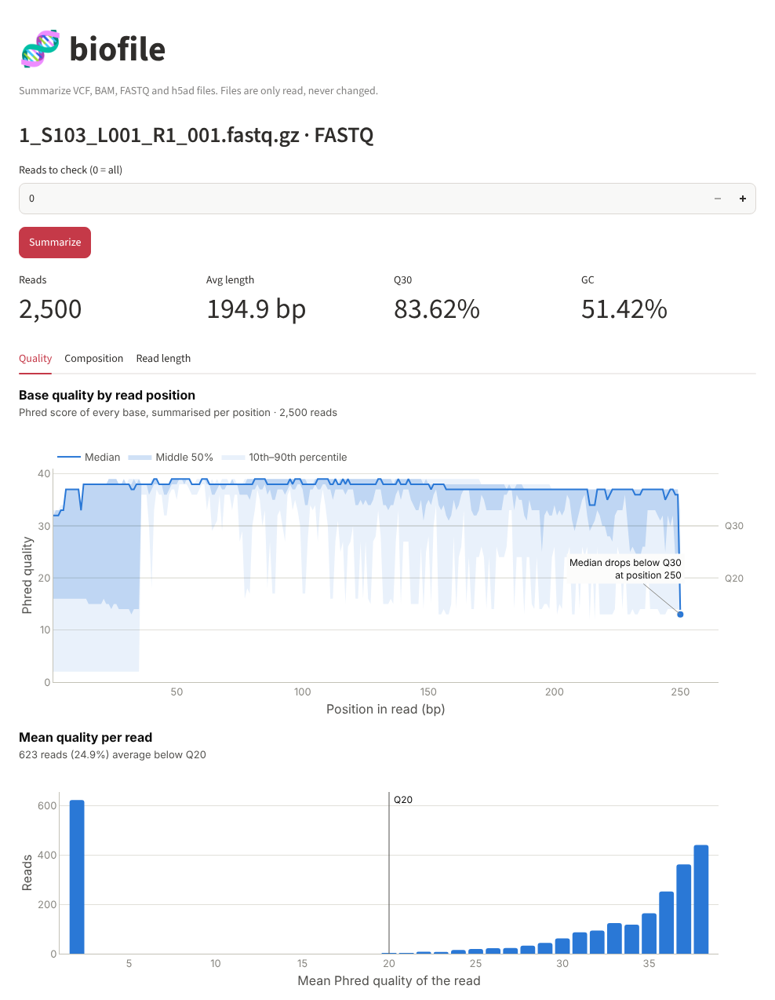
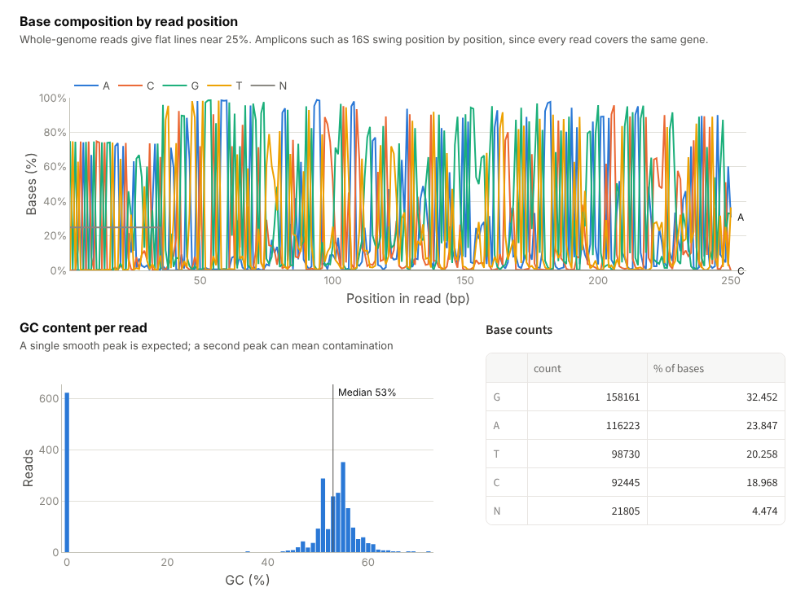
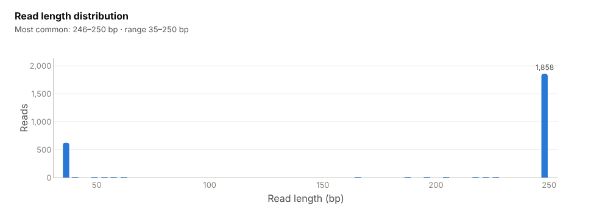

# FASTQ: sequencing reads

[Guide home](README.md) · **FASTQ** · [BAM](bam.md) · [VCF](vcf.md) · [h5ad](h5ad.md)

## What a FASTQ file is

A FASTQ file is what a sequencer produces: every read it measured, with a
quality score for every base. It is the starting point of almost every
analysis, so its quality limits everything that comes after. Files usually
end in `.fastq.gz` (compressed) and can hold anything from a few thousand to
billions of reads.

## What is inside

Each read takes exactly four lines. These are two reads from the example file:

```
@SRR10070132.1.1 1 length=35                     ← 1. read name
NNNNNNNNNNNNNNNNNNNNNNNNNNNNNNNNNNN              ← 2. sequence (N = unknown base)
+SRR10070132.1.1 1 length=35                     ← 3. separator
###################################              ← 4. one quality character per base
@SRR10070132.2.1 2 length=249
GTGTCAGCAGCCGCGGTAATACGTAGGGTGCGAGCGTTAATCGGAATTACTGGGCG...
+SRR10070132.2.1 2 length=249
AABBBFFFDFFAGGGGGGGGGGHFHHGGA2E2EFGGGG1FFHGGGGGHHGHGHHHG...
```

Each quality character encodes a Phred score: `#` is Q2 (almost certainly
wrong), `5` is Q20, `?` is Q30 and `I` is Q40. The first read above is 35
unknown bases with the lowest possible quality: a placeholder with no real
sequence. The second is a normal read that starts with the 16S primer
`GTGTCAGCAGCCGCGGTAA`.

## Files you need

| File | Needed? | Notes |
|---|---|---|
| `sample.fastq` or `sample.fastq.gz` | Yes | Plain or gzip-compressed. `.fq` works too |
| Index (`.fxi`) | No | pyfastx streams the file and writes nothing next to it |
| Mate file (`sample_R2.fastq.gz`) | No | Paired-end runs come as two files, `_R1` and `_R2`. Run each tool on each file; they are checked separately, not as pairs |

## Example file

`1_S103_L001_R1_001.fastq.gz`: the forward reads (R1) of one sample from a
bacterial 16S rRNA amplicon run, from the nf-core/ampliseq test data. Every
read is a copy of the same short stretch of the 16S gene, amplified with PCR
primers, so this is not whole-genome data.

---

## Tool: `fastq_stats`

**What it does.** Reads every read once and counts reads, bases, read lengths,
base qualities, GC content and unknown bases.

**Why it matters.** It answers "did the run work?" in one call: enough reads,
the expected read length, and most bases at Q30 or better. GC content far from
what the organism should have hints at contamination.

| Argument | Required | Meaning |
|---|---|---|
| `path` | Yes | The FASTQ file |
| `max_reads` | No | Stop after this many reads. Use about 1,000,000 for a quick look at a large file; the result is then marked `"sampled": true` |

**Run it**

```bash
python main.py real_data/1_S103_L001_R1_001.fastq.gz
```
```bash
npx @modelcontextprotocol/inspector --cli -e BIOFILE_ALLOWED_DIR=$PWD/real_data python server.py --method tools/call --tool-name fastq_stats --tool-arg path=1_S103_L001_R1_001.fastq.gz
```

> Ask: "How many reads are in 1_S103_L001_R1_001.fastq.gz and what is the Q30?"

**Output on the example file**

```json
{
  "file": "real_data/1_S103_L001_R1_001.fastq.gz",
  "reads": 2500,
  "sampled": false,
  "total_bases": 487364,
  "min_len": 35,
  "avg_len": 194.9,
  "max_len": 250,
  "mean_base_quality": 33.26,
  "q20_pct": 87.55,
  "q30_pct": 83.62,
  "gc_pct": 51.42,
  "n_bases": 21805,
  "lowercase_bases": 0,
  "other_characters": 0,
  "base_counts": {"N": 21805, "G": 158161, "T": 98730, "C": 92445, "A": 116223}
}
```

| Field | Here | Meaning |
|---|---|---|
| `reads` | 2,500 | Reads examined. `sampled: false` means the whole file was read |
| `total_bases` | 487,364 | Sum of all read lengths |
| `min_len`, `avg_len`, `max_len` | 35, 194.9, 250 | Shortest, average and longest read in bases |
| `mean_base_quality` | 33.26 | Average Phred score over all bases |
| `q20_pct`, `q30_pct` | 87.55, 83.62 | Percentage of bases at Q20 or better and at Q30 or better |
| `gc_pct` | 51.42 | Percentage of bases that are G or C |
| `n_bases` | 21,805 | Unknown bases (`N`) |
| `lowercase_bases` | 0 | Bases written in lower case. Raw sequencer output has none, so a non-zero value means the reads were edited |
| `other_characters` | 0 | Anything other than A, C, G, T and N |
| `base_counts` | | Count of every character seen |

**What this tells us.** The run itself is good: 83.6% of bases are at Q30 or
better. But 21,805 bases are `N`, and 21,805 is exactly 623 × 35: 623 reads
(25% of the file) are the 35-base placeholders shown above. They pull the
average length down to 194.9 and need removing before analysis, for example
with `fastp` or `cutadapt --max-n 0`.

---

## Tool: `fastq_quality_profile`

**What it does.** Looks at quality and base composition position by position
along the read, and builds per-read histograms of length, average quality and
GC content. These are the same views as a FastQC report.

**Why it matters.** Quality almost always falls toward the end of a read.
This tool shows where it falls, which is where to trim. The composition and
GC views reveal adapters, primers and contamination.

| Argument | Required | Meaning |
|---|---|---|
| `path` | Yes | The FASTQ file |
| `max_reads` | No | Reads to examine, from the start of the file. Default 100,000, which gives a stable profile; `null` reads everything |
| `max_points` | No | Most positions to return (default 300). Longer reads are grouped into equal bins |

**Run it**

```bash
npx @modelcontextprotocol/inspector --cli -e BIOFILE_ALLOWED_DIR=$PWD/real_data python server.py --method tools/call --tool-name fastq_quality_profile --tool-arg path=1_S103_L001_R1_001.fastq.gz
```

> Ask: "Where does quality drop in 1_S103_L001_R1_001.fastq.gz? Should I trim?"

**Output on the example file** (each list has one value per read position, 250
in total; only the first three are shown)

```json
{
  "reads": 2500,
  "sampled": false,
  "position_start": [1, 2, 3, ...],
  "median": [32, 32, 32, ...],
  "q1": [16, 16, 16, ...],
  "p10": [2, 2, 2, ...],
  "reads_covering": [2500, 2500, 2500, ...],
  "median_below_q30_from": 250,
  "median_below_q20_from": 250,
  "length_start": [35, 39, 43, ...],
  "length_reads": [623, 2, 0, ...],
  "base_pct": {"G": [74.92, 0.32, 74.56, ...], "T": [0.12, 74.76, 0.28, ...], "N": [24.92, 24.92, 24.92, ...], ...},
  "read_quality": {"quality": [2, 20, 21, ...], "reads": [623, 1, 1, ...]},
  "read_gc": {"gc_pct": [0, 36, 43, ...], "reads": [623, 2, 1, ...]}
}
```

| Field | Meaning |
|---|---|
| `position_start`, `position_end` | Read position (from 1) of each point. Equal when each point is one base |
| `mean`, `median`, `q1`, `q3`, `p10`, `p90` | Quality at that position across all reads: average, middle value, quartiles, and 10th/90th percentiles |
| `reads_covering` | How many reads are long enough to reach that position |
| `median_below_q30_from`, `median_below_q20_from` | First position where the median quality drops below Q30 / Q20; `null` if it never does. A natural trimming point |
| `length_start`, `length_end`, `length_reads` | Read-length histogram |
| `base_pct` | Percentage of A, C, G, T and N at each position |
| `read_quality` | How many reads have each average quality |
| `read_gc` | How many reads have each GC percentage |

**What this tells us.**

- The median stays between Q32 and Q39 up to position 249 and falls below
  Q30 only at position 250, which just 326 reads reach. No real trimming is
  needed.
- The 10th percentile is Q2 for positions 1–35: those are the 623 `N`
  placeholder reads again, which also form the spike at quality 2 in
  `read_quality` and at 0% GC in `read_gc`.
- At position 1, 75% of bases are G and the rest are N; at position 2, 75%
  are T. Every real read starts with the same primer. That is normal for
  amplicon data and would be a warning sign for whole-genome data.

---

## In the web interface

Open the file with **Path on this computer** and press **Summarize**. The
headline numbers come from `fastq_stats`; the charts come from
`fastq_quality_profile`.

### Quality tab



- **Base quality by read position.** The dark line is the median quality at
  each position; the shaded bands hold the middle 50% and the middle 80% of
  bases. The grey lines mark Q30 and Q20. Here the median stays well above
  Q30 and only drops at the very last base. The pale band reaching down to Q2 over
  the first 35 positions is the placeholder reads.
- **Mean quality per read.** One bar per average quality. A healthy run is
  one tall group on the right; here there is also a bar of 623 reads at Q2,
  which the subtitle counts as reads averaging below Q20.

### Composition tab



- **Base composition by read position.** For whole-genome reads, the four
  lines run flat near 25% each. For an amplicon every read has the same
  sequence, so the lines swing between 0% and 100% from position to
  position. That pattern is expected here. The flat N line at 25% over the
  first 35 positions is the placeholder reads.
- **GC content per read.** Reads should form one smooth peak near the
  organism's GC content. The peak here is around 53%, plus a bar at 0% for
  the placeholder reads. A second peak elsewhere would point to
  contamination.
- **Base counts.** The exact counts behind `fastq_stats`. N is 4.5% of all
  bases.

### Read length tab



Untrimmed Illumina reads all have the same length. Here 1,858 reads are
246–250 bases, the length the run was set to, and 623 are the 35-base
placeholders. A spread of lengths in between means the reads were already
trimmed.

---

## Common problems

| Message or symptom | Cause | What to do |
|---|---|---|
| `RuntimeError` saying the file is not FASTQ | The file is FASTA (lines start with `>`), truncated, or not a sequence file | Check the first lines with `zcat file.fastq.gz \| head -8` |
| `reads: 0` and a `warning` | The file is empty | Check the download or demultiplexing step |
| A call on a large file takes minutes | `fastq_stats` reads every read by default | Pass `max_reads`, for example 1,000,000 |
| R1 looks good and R2 looks worse | Normal: the second read is sequenced later and its quality drops sooner | Trim R2 more, or check that it still overlaps R1 if you merge pairs |
