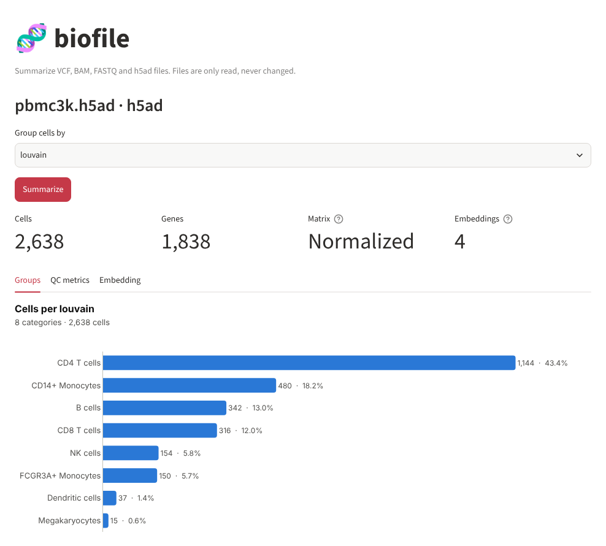
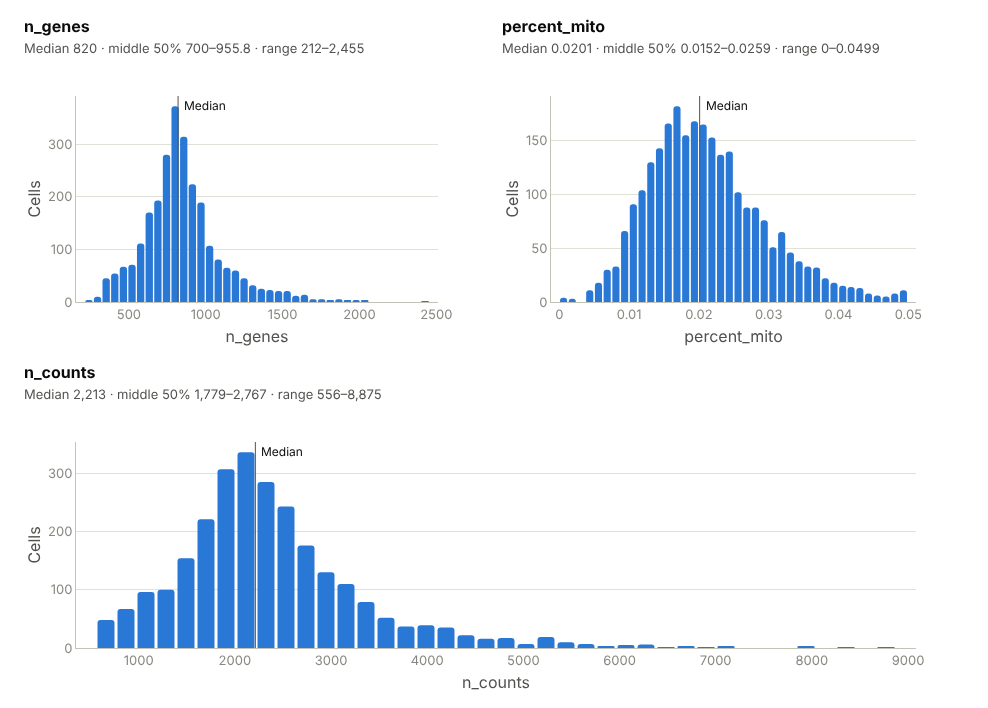
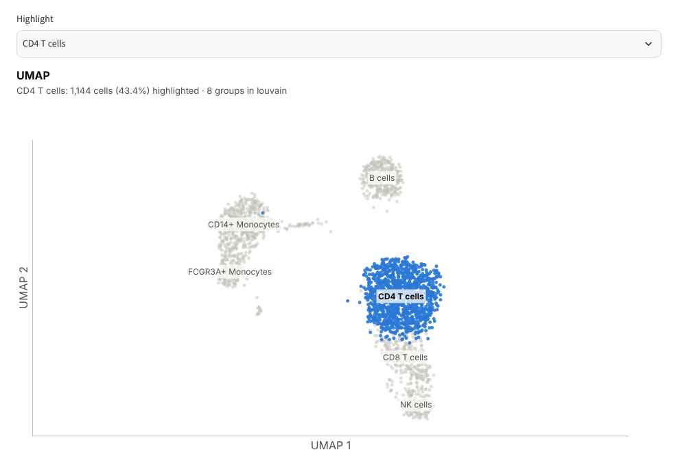

# h5ad: single-cell data

[Guide home](README.md) · [FASTQ](fastq.md) · [BAM](bam.md) · [VCF](vcf.md) · **h5ad**

## What an h5ad file is

An `.h5ad` file stores an AnnData object: the standard container for
single-cell RNA-seq data in Python (Scanpy, scvi-tools, CELLxGENE). It holds
a matrix of how much each gene is expressed in each cell, together with
everything learned about the cells and genes along the way: QC metrics,
cluster labels, cell types and 2-D maps such as UMAP. It is produced by
pipelines such as Cell Ranger plus Scanpy, and shared by data portals such as
CELLxGENE.

## What is inside

An h5ad file is an HDF5 file with a fixed set of parts:

```
AnnData object with n_obs × n_vars = 2638 × 1838
    X       the expression matrix: one row per cell, one column per gene
    obs     a table with one row per cell:  'n_genes', 'percent_mito', 'n_counts', 'louvain'
    var     a table with one row per gene:  'n_cells'
    obsm    per-cell coordinates:           'X_pca', 'X_tsne', 'X_umap', 'X_draw_graph_fr'
    obsp    cell-to-cell graphs:            'distances', 'connectivities'
    uns     anything else: colours, cluster marker genes, settings
    layers  other versions of X, such as raw counts (none here)
    raw     an earlier copy of X and var, kept before filtering
```

The first rows of `obs` in the example file:

| Cell barcode | `n_genes` | `percent_mito` | `n_counts` | `louvain` |
|---|---|---|---|---|
| `AAACATACAACCAC-1` | 781 | 0.0302 | 2419 | CD4 T cells |
| `AAACATTGAGCTAC-1` | 1352 | 0.0379 | 4903 | B cells |
| `AAACATTGATCAGC-1` | 1131 | 0.0089 | 3147 | CD4 T cells |

Each row is one cell, named by its barcode. `n_genes` is how many genes were
detected in the cell, `n_counts` how many RNA molecules were counted,
`percent_mito` the share of those from mitochondrial genes, and `louvain`
the cluster the cell was assigned to, here named by cell type.

## Files you need

| File | Needed? | Notes |
|---|---|---|
| `data.h5ad` | Yes | One file holds everything. It is opened read-only and the matrix is not loaded into memory, so multi-gigabyte files are fine |
| `.loom`, `.rds`, Cell Ranger `matrix.mtx` folders | Not read | Convert to h5ad first, for example with Scanpy (`sc.read_10x_mtx(...).write_h5ad(...)`) |

## Example file

`pbmc3k.h5ad`: about 2,700 blood cells (peripheral blood mononuclear cells,
PBMC) from a healthy donor, sequenced by 10x Genomics. This copy, from the
CELLxGENE example data, has been through the standard Scanpy tutorial:
filtered to 2,638 cells and 1,838 highly variable genes, clustered, and each
cluster labelled with a cell type.

---

## Tool: `h5ad_summary`

**What it does.** Opens the file without loading the matrix and reports its
size, the names of the cell and gene columns, the embeddings and graphs, and
whether the matrix holds raw counts. With `column`, it also counts the cells
in each group of that column.

**Why it matters.** It answers "what is in this file?" before you write any
code: which annotations exist, whether clustering and a UMAP were already
done, and whether the matrix is raw or processed. That last point matters
because many methods, such as differential expression with DESeq2 or
modelling with scVI, need raw counts and give wrong results on normalized
data.

| Argument | Required | Meaning |
|---|---|---|
| `path` | Yes | The h5ad file |
| `column` | No | A column of `obs` to count cells by, such as `louvain`, `leiden`, `cell_type` or `sample` |

**Run it**

```bash
python main.py real_data/pbmc3k.h5ad --column louvain
```
```bash
npx @modelcontextprotocol/inspector --cli -e BIOFILE_ALLOWED_DIR=$PWD/real_data python server.py --method tools/call --tool-name h5ad_summary --tool-arg path=pbmc3k.h5ad column=louvain
```

> Ask: "What's in pbmc3k.h5ad, and how many cells of each type are there?"

**Output on the example file**

```json
{
  "file": "real_data/pbmc3k.h5ad",
  "n_cells": 2638,
  "n_genes": 1838,
  "cell_columns": ["n_genes", "percent_mito", "n_counts", "louvain"],
  "gene_columns": ["n_cells"],
  "embeddings": ["X_pca", "X_tsne", "X_umap", "X_draw_graph_fr"],
  "neighbor_graphs": ["distances", "connectivities"],
  "X_looks_like": "normalized or scaled",
  "cells_per_louvain": {
    "CD4 T cells": 1144, "CD14+ Monocytes": 480, "B cells": 342, "CD8 T cells": 316,
    "NK cells": 154, "FCGR3A+ Monocytes": 150, "Dendritic cells": 37, "Megakaryocytes": 15
  }
}
```

| Field | Here | Meaning |
|---|---|---|
| `n_cells`, `n_genes` | 2,638, 1,838 | Rows and columns of the matrix |
| `cell_columns`, `gene_columns` | | Column names of `obs` and `var`: what is known about each cell and gene |
| `embeddings` | 4 | Coordinates in `obsm`. `X_pca` is used for clustering; `X_umap`, `X_tsne` and `X_draw_graph_fr` are 2-D maps for plotting |
| `neighbor_graphs` | 2 | Which cells are similar to which, used for clustering and UMAP |
| `X_looks_like` | `normalized or scaled` | `raw counts` if the sampled values are all whole numbers of 0 or more, otherwise `normalized or scaled` |
| `cells_per_louvain` | | Cells per group of the chosen column, largest first |

**What this tells us.** The file is fully processed: clusters, cell-type
labels and a UMAP are already there. `X` holds scaled values (some are
negative) for only the 1,838 most variable genes, so it is suitable for
plotting but not for count-based methods. The file also keeps a `raw`
section, which biofile does not inspect. CD4 T cells are the largest group
(43%) and megakaryocytes the smallest (15 cells), which matches what blood
normally contains.

---

## Tool: `h5ad_column_stats`

**What it does.** Describes one `obs` column. For numbers, it returns the
minimum, quartiles, mean, maximum, missing values and a histogram. For
labels, it returns how many cells carry each one.

**Why it matters.** Cell QC is done by cutting off the tails of a few
columns: cells with very few genes are often empty droplets, cells with very
many may be two cells captured together (doublets), and a high
mitochondrial share often marks dying cells. The distribution shows where
those cut-offs should go, and whether they were already applied.

| Argument | Required | Meaning |
|---|---|---|
| `path` | Yes | The h5ad file |
| `column` | Yes | A column of `obs`, such as `n_genes` or `percent_mito` |
| `bins` | No | Histogram bins for a numeric column (default 40) |

**Run it**

```bash
npx @modelcontextprotocol/inspector --cli -e BIOFILE_ALLOWED_DIR=$PWD/real_data python server.py --method tools/call --tool-name h5ad_column_stats --tool-arg path=pbmc3k.h5ad column=percent_mito
```

> Ask: "Show the distribution of percent_mito in pbmc3k.h5ad. Was it filtered?"

**Output on the example file** (histogram lists shortened)

```json
{
  "file": "real_data/pbmc3k.h5ad",
  "column": "percent_mito",
  "n_cells": 2638,
  "kind": "numeric",
  "min": 0.0, "q1": 0.0152, "median": 0.0201, "mean": 0.0212, "q3": 0.0259, "max": 0.0499,
  "missing": 0,
  "histogram": {"start": [...], "end": [...], "count": [...]}
}
```

| Field | Here | Meaning |
|---|---|---|
| `kind` | `numeric` | `numeric` gives the statistics below; `categorical` gives `counts` instead |
| `min`, `q1`, `median`, `mean`, `q3`, `max` | | Smallest value, quartiles, average and largest value |
| `missing` | 0 | Cells with no value |
| `histogram` | | Cells per value range, as `start`, `end` and `count` lists |
| `counts` | | Categorical columns only: cells per label, largest first |

**What this tells us.** `percent_mito` is stored as a fraction, not a
percentage: 0.02 means 2%. The maximum is just under 0.05 and nothing lies
above it, so cells with 5% or more mitochondrial reads were already removed,
the cut-off used in the Scanpy PBMC tutorial. The other QC columns:

| Column | Median | Middle 50% | Range |
|---|---|---|---|
| `n_genes` | 820 | 700–956 | 212–2,455 |
| `n_counts` | 2,213 | 1,779–2,767 | 556–8,875 |

A suitable cut-off depends on the tissue and the technology, so read these
against the distributions rather than against fixed numbers.

---

## In the web interface

Open the file with **Path on this computer**, choose a column under **Group
cells by** (here `louvain`) and press **Summarize**. The numbers at the top
are cells, genes, whether the matrix is raw counts or normalized, and how many
embeddings the file has (hover the question mark to see their names).

### Groups tab



Cells per group of the chosen column, from `h5ad_summary`. Use it to check
that expected cell types are present, and that no single sample or cluster
dominates by mistake.

### QC metrics tab



One histogram per numeric `obs` column, from `h5ad_column_stats`, with the
median marked. Each one should be a single main peak. Here the hard edge of
`percent_mito` at 0.05 shows the filter that was applied, and the long right
tail of `n_counts` holds the cells with the most RNA, where doublets are most
likely.

### Embedding tab



The cells drawn on their UMAP map, with one group highlighted (pick it under
**Highlight**). Cells that are alike sit close together, so each cell type
should form its own island. Here CD4 T cells sit next to CD8 T and NK cells,
and the monocytes form a separate group. A cell type scattered over several
islands can point to a batch effect or a wrong label. This view is
part of the web interface only; it is not an MCP tool, because the
coordinates of thousands of cells are too large to send to an AI model.

---

## Common problems

| Message or symptom | Cause | What to do |
|---|---|---|
| `Column 'leiden' not found. Available: [...]` | The column has a different name in this file | Use a name from the list in the message |
| `OSError` when opening | The file is not HDF5, is incomplete, or is a `.loom`/`.h5` file | Check the download; convert other formats with Scanpy |
| `X_looks_like` is `raw counts` but the data was normalized | Only a sample of values is checked, and a few normalized datasets keep whole numbers | Check `adata.X` directly before relying on it |
| `X_looks_like` is `normalized or scaled` and you need counts | Raw counts are often kept in `layers["counts"]` or `raw` | Look there before re-running the pipeline |
