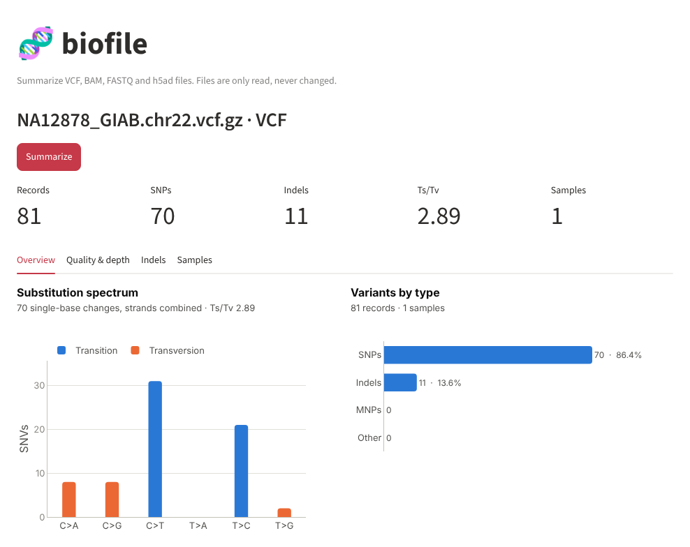
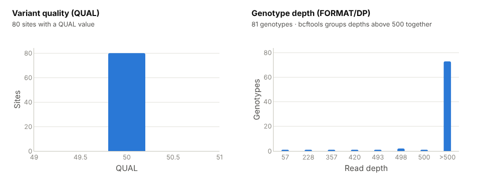
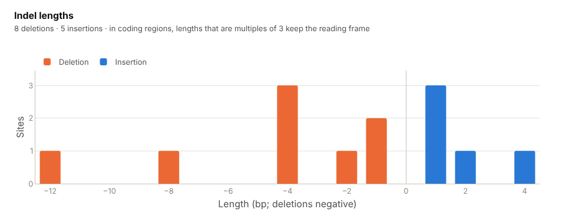
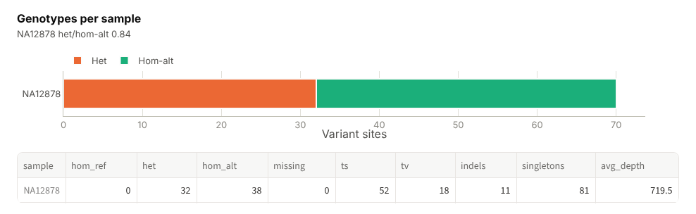

# VCF: variant calls

[Guide home](README.md) · [FASTQ](fastq.md) · [BAM](bam.md) · **VCF** · [h5ad](h5ad.md)

## What a VCF file is

A VCF (Variant Call Format) file lists the places where a sample's DNA differs
from the reference genome, and the genotype of each sample at those places. A
variant caller such as GATK HaplotypeCaller, DeepVariant, FreeBayes or
`bcftools call` produces it from BAM files. It is usually the end product of a
DNA sequencing pipeline and the input for annotation, filtering and
interpretation.

A VCF can hold one sample or thousands. `.vcf.gz` is the compressed form and
`.bcf` the binary form; biofile reads all three.

## What is inside

A **header** of `##` lines describing the file, then one column-name line:

```
##fileformat=VCFv4.2
##contig=<ID=chr22,length=50818468,assembly=human_GRCh38_no_alt_analysis_set.fasta>
##FILTER=<ID=questionableindel,Description="...">
#CHROM  POS  ID  REF  ALT  QUAL  FILTER  INFO  FORMAT  NA12878
```

Then one **record per variant site**. A real record from the example file:

| Column | Value | Meaning |
|---|---|---|
| `CHROM`, `POS` | `chr22`, `16571233` | Where the variant is |
| `ID` | `chr22:16571233:G:A` | A name for the variant, such as a dbSNP rsID; `.` if none |
| `REF`, `ALT` | `G`, `A` | The reference base and the alternative seen in the sample. A G>A change is a SNP; different lengths, such as `AATAT` > `AAT`, make an indel |
| `QUAL` | `50` | The caller's confidence that a variant exists here |
| `FILTER` | `PASS` | `PASS`, or the name of the filter the site failed |
| `INFO` | `platforms=4;...` | Site-level notes written by the caller |
| `FORMAT` | `GT:PS:DP:ADALL:AD:GQ` | The order of the per-sample fields that follow |
| `NA12878` | `0/1:.:958:188,241:36,39:184` | This sample: genotype `0/1` (one copy of each allele, heterozygous), depth 958, genotype quality 184 |

Genotypes use allele numbers: `0` is the reference and `1` the first ALT, so
`0/0` is homozygous reference, `0/1` heterozygous, `1/1` homozygous
alternative, and `./.` missing.

## Files you need

| File | Needed? | Notes |
|---|---|---|
| `calls.vcf`, `calls.vcf.gz` or `calls.bcf` | Yes | A `.vcf.gz` must be bgzip-compressed, as variant callers write it |
| Index (`.tbi`, `.csi`) | No | `bcftools stats` reads the file from start to end |
| Reference genome, BAM | No | |

## Example file

`NA12878_GIAB.chr22.vcf.gz`: 81 variants from a 37 kb stretch of chromosome 22
(positions 16,571,233–16,608,171, GRCh38) in the Genome in a Bottle benchmark
for sample NA12878, as used in the nf-core test data. Genome in a Bottle
combines several technologies into a high-confidence "truth set" used to test
variant callers. Every site has QUAL 50 and `PASS`, because the values are set
by the benchmark rather than scored by one caller.

---

## Tool: `vcf_stats`

**What it does.** Runs `bcftools stats` on the whole file and returns counts
by variant type, the transition/transversion ratio, the 12 kinds of base
change, distributions of QUAL, indel length and genotype depth, and genotype
counts for each sample.

**Why it matters.** These are the standard sanity checks on a call set:

- **Ts/Tv** (transitions over transversions). Transitions (A↔G, C↔T) are
  about twice as common as transversions in real human variation: roughly 2.0–2.1
  genome-wide and 2.8–3.3 in exomes. Random errors have no such bias and
  pull the ratio toward 0.5, so a low Ts/Tv is a sign of false calls.
- **Heterozygous vs homozygous-alternative** genotypes per sample. Far too
  many heterozygous calls can mean contamination or a mixed sample.
- **Missing genotypes and singletons** per sample in a cohort. One sample
  standing out usually has a data problem.
- **Indel lengths.** Most indels are 1–2 bases; in coding regions, lengths
  that are multiples of 3 keep the protein's reading frame and are enriched.

| Argument | Required | Meaning |
|---|---|---|
| `path` | Yes | The VCF or BCF file |

**Run it**

```bash
python main.py real_data/NA12878_GIAB.chr22.vcf.gz
```
```bash
npx @modelcontextprotocol/inspector --cli -e BIOFILE_ALLOWED_DIR=$PWD/real_data python server.py --method tools/call --tool-name vcf_stats --tool-arg path=NA12878_GIAB.chr22.vcf.gz
```

> Ask: "Summarize NA12878_GIAB.chr22.vcf.gz. Does the Ts/Tv look right?"

**Output on the example file**

```json
{
  "file": "real_data/NA12878_GIAB.chr22.vcf.gz",
  "samples": 1,
  "records": 81,
  "no-ALTs": 0,
  "SNPs": 70,
  "MNPs": 0,
  "indels": 11,
  "others": 0,
  "multiallelic sites": 3,
  "multiallelic SNP sites": 0,
  "ts": 52,
  "tv": 18,
  "ts_tv": 2.89,
  "substitutions": {"A>C": 1, "A>G": 13, "A>T": 0, "C>A": 4, "C>G": 4, "C>T": 13,
                    "G>A": 18, "G>C": 4, "G>T": 4, "T>A": 0, "T>C": 8, "T>G": 1},
  "qual": {"start": [50], "end": [50], "count": [80]},
  "indel_lengths": {"length": [-12, -8, -4, -2, -1, 1, 2, 4], "sites": [1, 1, 3, 1, 2, 3, 1, 1]},
  "genotype_depth": {"depth": ["57", "228", "357", "420", "493", "498", "500", ">500"],
                     "genotypes": [1, 1, 1, 1, 1, 2, 1, 73]},
  "per_sample": [
    {"sample": "NA12878", "hom_ref": 0, "het": 32, "hom_alt": 38, "missing": 0,
     "ts": 52, "tv": 18, "indels": 11, "singletons": 81, "avg_depth": 719.5}
  ]
}
```

| Field | Here | Meaning |
|---|---|---|
| `samples`, `records` | 1, 81 | Sample columns and variant lines |
| `SNPs`, `MNPs`, `indels`, `others` | 70, 0, 11, 0 | Records by type: single-base changes, multi-base changes, insertions/deletions, anything else |
| `no-ALTs` | 0 | Records with no alternative allele (reference-only sites) |
| `multiallelic sites` | 3 | Sites with more than one ALT allele, such as `AATAT` > `AAT,A` |
| `ts`, `tv`, `ts_tv` | 52, 18, 2.89 | Transitions, transversions and their ratio |
| `substitutions` | | Count of each base change as written in the file. `C>T` and `G>A` are the same change on opposite strands |
| `qual` | | Sites per QUAL value |
| `indel_lengths` | | Indel alleles per length; deletions are negative. A multiallelic site counts once per allele, so the 11 indel records give 13 alleles |
| `genotype_depth` | | Genotypes per read depth (`FORMAT/DP`). bcftools groups everything above 500 as `">500"` |
| `per_sample` | | For each sample: genotype counts at SNP sites (`hom_ref`, `het`, `hom_alt`, `missing`; here 32 + 38 = the 70 SNPs), its transitions and transversions, indels, singletons (variants seen in no other sample) and average depth |

**What this tells us.** A small, clean call set. Ts/Tv is 2.89, above the
genome-wide 2.0–2.1, and the het/hom-alt ratio is 0.84, below the usual
1.5–2. With 70 SNPs from one 37 kb stretch, a few sites move either ratio a
lot, so neither is a warning here. On a whole genome, they would both be
worth a look. Every variant is a "singleton" simply because the file has one
sample. Depths above 500 come from the benchmark, which pools reads from
several sequencing datasets.

---

## In the web interface

Open the VCF with **Path on this computer** and press **Summarize**. The five
numbers at the top are records, SNPs, indels, Ts/Tv and samples.

### Overview tab



- **Substitution spectrum.** The 12 base changes folded into 6 by strand
  (`G>A` counts as `C>T`), with transitions in blue and transversions in
  orange. In real data the blue C>T and T>C bars are the tallest, as here.
  Flat bars across all six suggest many errors. A large excess of C>A can
  mean DNA damage from sample preparation.
- **Variants by type.** Records per type: 86% SNPs and 14% indels here.

### Quality & depth tab



- **Variant quality (QUAL).** For calls from a single caller this is a wide
  spread, and a large group of low values points to weak calls left
  unfiltered. Here every site has 50, the value set by the benchmark.
- **Genotype depth.** Reads behind each genotype. Calls from fewer than about
  10 reads are less reliable. Almost all genotypes here are above 500.

### Indels tab



Indel lengths, deletions to the left of zero and insertions to the right.
Normal data peaks at ±1 and falls off quickly.

### Samples tab



Heterozygous and homozygous-alternative genotypes per sample, with the full
per-sample table underneath. With many samples, look for one whose bars or
missing count differ clearly from the rest.

---

## Common problems

| Message or symptom | Cause | What to do |
|---|---|---|
| `SamtoolsError` mentioning the file | The file is not VCF/BCF, is truncated, or a `.gz` was made with plain `gzip` instead of `bgzip` | `zcat file.vcf.gz \| bgzip > fixed.vcf.gz`, or check the file with `bcftools view -h` |
| `samples: 0` and an empty `per_sample` | A sites-only VCF, such as a population database, has no genotype columns | Expected; the site-level numbers still apply |
| `ts_tv` near 1 or lower | Many false SNP calls, or a file of somatic or damaged-DNA calls | Check that filters were applied (`FILTER` column) and compare with a known-good sample |
| `genotype_depth` is empty | The caller did not write `FORMAT/DP` | Expected for some callers |
